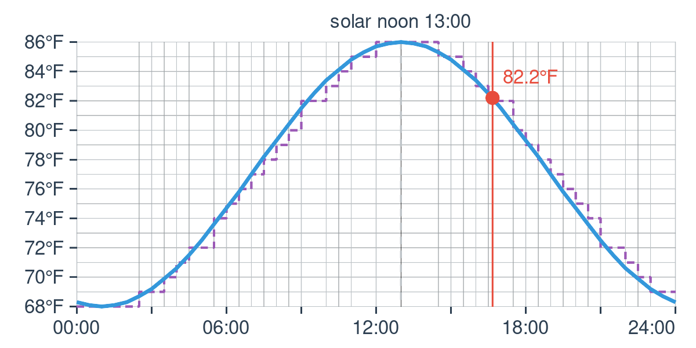
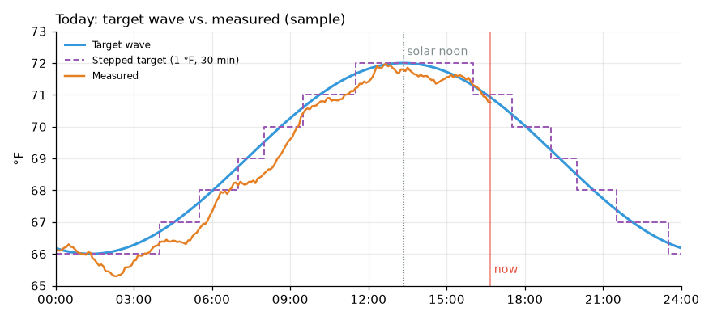

# Daily Temperature Wave for Home Assistant


[](https://github.com/minchinweb/ha-daily-temperature-wave/actions/workflows/test.yml)
[](https://github.com/minchinweb/ha-daily-temperature-wave/actions/workflows/validate.yml)

A target temperature that follows the sun, for use as a heating or cooling
setpoint. It peaks at **solar noon** (which can be an hour and a half or more
from "wall clock" noon) and bottoms out at solar midnight, following a smooth
daily (sine) wave between the minimum and maximum you choose.

There is also a **stepwise** version for thermostats with coarse schedules:
for example, an Ecobee schedule that only takes a temperature every half hour,
in whole degrees Fahrenheit.

## Installation

[](https://my.home-assistant.io/redirect/hacs_repository/?owner=minchinweb&repository=ha-daily-temperature-wave&category=integration)

Or by hand: in HACS, add `https://github.com/minchinweb/ha-daily-temperature-wave`
as a [custom repository](https://hacs.xyz/docs/faq/custom_repositories/) of
type "Integration", then search for "Daily Temperature Wave" and download it.
Restart Home Assistant.

Then add the integration:

[](https://my.home-assistant.io/redirect/config_flow_start?domain=daily_temperature_wave)

or go to **Settings → Devices & Services → Add Integration** and search for
"Daily Temperature Wave". You can add it more than once (e.g. one wave per
room), and change the settings later with **Configure**.

After setup, the integration doesn't appear under **Integrations**, because it's a
service rather than a device. Find it under **Settings → Devices & Services**,
in **Devices** (or **Entities**, filtered by "Daily Temperature Wave").

Requires Home Assistant 2025.2 or newer.

## Settings

Configured in the UI; there is no YAML configuration.

| Setting               | Default | Description                                                                                                                                                      |
| --------------------- | ------- | ---------------------------------------------------------------------------------------------------------------------------------------------------------------- |
| Name                  | Daily Temperature Wave | Names the device and its entities.                                                                                                                |
| Minimum temperature   | `20C`   | Reached at solar midnight. Accepts `C` or `F`, e.g. `68F`; a bare number is Celsius.                                                                             |
| Maximum temperature   | `30C`   | Reached at solar noon.                                                                                                                                           |
| Peak sharpness        | `1.0`   | The wave's shape. `1.0` is a plain sine wave; higher values (up to 5) give a shorter, sharper warm peak and a longer cool spell; lower values (to 0.2) a broader peak. |
| Peak offset           | `0`     | Minutes the peak comes after solar noon (negative: before). |
| Step size             | `1F`    | The stepwise sensors round to this, e.g. `1F` or `0.5C`.                                                                                                         |
| Step interval         | 30 min  | The stepwise sensors hold each value this long, counted from midnight (30 = changes on the hour and half hour).                                                 |
| Solar noon override   | (empty) | A fixed time to use instead of solar noon. When empty, solar noon is calculated for each day from your Home Assistant location.                                 |

Sample charts for a range of peak sharpness values are in [docs/peak-sharpness.md](docs/peak-sharpness.md).

Temperatures are shown in your Home Assistant unit system (Settings → System →
General), whatever unit you typed them in.

## Entities

With the default name, the entities are:

| Entity                                              | State                                                                 | Attributes                                                                                          |
| --------------------------------------------------- | --------------------------------------------------------------------- | --------------------------------------------------------------------------------------------------- |
| `sensor.daily_temperature_wave_current`             | The wave's temperature now                                            | `solar_noon`, `hours_from_noon`, `rising`                                                           |
| `sensor.daily_temperature_wave_current_step`        | The stepwise temperature now                                          |                                                                                                     |
| `sensor.daily_temperature_wave_next_hour` | The temperature at the start of the next hour | `forecast`: 24 hourly `{datetime, temperature}` |
| `sensor.daily_temperature_wave_next_step` | The stepwise temperature for the next step | `forecast`: every step for the next 24 hours, `{datetime, temperature}`; `schedule`: today's changes, `{datetime, time, temperature}` |
| `sensor.daily_temperature_wave_high_today` | Today's high (the wave's peak) | `forecast`: 7 days of `{date, solar_noon, high, low}` |
| `sensor.daily_temperature_wave_low_today` | Today's low (the wave's bottom) | `forecast`: 7 days of `{date, solar_noon, high, low}` |
| `sensor.daily_temperature_wave_high_today_step` | Today's high, rounded to the step | as above, rounded to the step |
| `sensor.daily_temperature_wave_low_today_step` | Today's low, rounded to the step | as above, rounded to the step |
| `image.daily_temperature_wave_chart`                | A chart of today's wave (the state is when it was last drawn)         | `points`: today's curve, every 30 minutes, `{datetime, temperature}`                                |
| `binary_sensor.daily_temperature_wave_rising`       | On from solar midnight to solar noon, while the temperature rises     |                                                                                                     |
| `binary_sensor.daily_temperature_wave_falling`      | On from solar noon to solar midnight, while the temperature falls     |                                                                                                     |
| `binary_sensor.daily_temperature_wave_rising_step`  | On in an interval where the stepped temperature goes up               |                                                                                                     |
| `binary_sensor.daily_temperature_wave_falling_step` | On in an interval where the stepped temperature goes down             |                                                                                                     |

Everything updates at the start of each minute, except the chart, which is
redrawn every 5 minutes. Forecast, schedule and point attributes are not
recorded in history.

## Dashboards

See today's wave, graph it against the temperatures you measure, and list
the schedule to type into a thermostat:

- **Chart**: the chart image entity shows today's wave, its steps, solar noon
  and now in the built-in Picture Entity card, with nothing to install.

  

- **Compare with measured temperatures**: the [ApexCharts card](https://github.com/RomRider/apexcharts-card)
  (from HACS) plots the whole of today's wave, the stepped target and your
  measured temperature. The built-in History graph card can compare the past
  24 hours.
- **Schedule table**: the built-in Markdown card lists the times the stepped
  temperature changes, e.g. to set up an Ecobee schedule.



*A sample, drawn from the wave's formula with made-up readings.*

The card YAML for all of these is in [docs/dashboard.md](docs/dashboard.md).

## Examples

Use the wave as a thermostat setpoint:

```yaml
automation:
  - alias: "Follow the temperature wave"
    triggers:
      - trigger: state
        entity_id: sensor.daily_temperature_wave_current_step
    actions:
      - action: climate.set_temperature
        target:
          entity_id: climate.living_room
        data:
          temperature: "{{ states('sensor.daily_temperature_wave_current_step') | float }}"
```

## Troubleshooting

- **Solar noon looks wrong**: check your home location (Settings → System →
  General → Location), or set the solar noon override.
- **Logs**: add this to `configuration.yaml` and restart:

  ```yaml
  logger:
    logs:
      custom_components.daily_temperature_wave: debug
  ```

## Contributing

See [docs/development.md](docs/development.md) for the tooling, running the
tests and trying changes in a real Home Assistant. Bug reports and ideas are
welcome in the [issues](https://github.com/minchinweb/ha-daily-temperature-wave/issues).

## Changelog

See [CHANGELOG.rst](CHANGELOG.rst).

## License

MIT; see [LICENSE.txt](LICENSE.txt).
