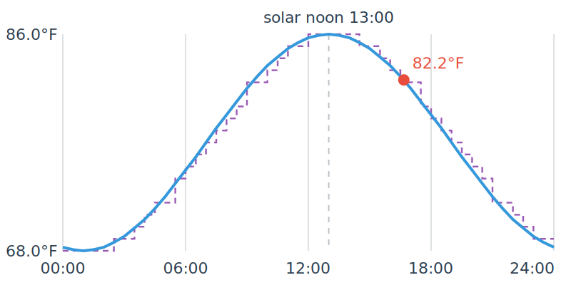
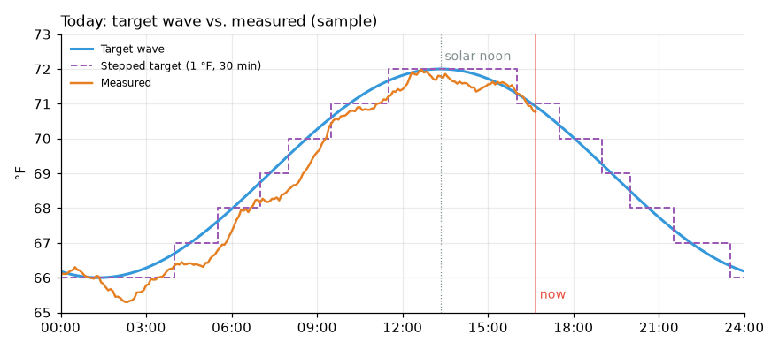

# Dashboard cards

Ways to see the wave, compare it with the temperatures you measure, and list
the schedule to set up a thermostat. No custom card is needed: each example is
a built-in card or the [ApexCharts card](https://github.com/RomRider/apexcharts-card)
from HACS. The entity ids assume the default name, "Daily Temperature Wave";
replace `sensor.living_room_temperature` with your own thermometer or
thermostat's temperature sensor.

## Today's chart (built-in Picture Entity)

The integration draws its own chart of today: the wave, the stepped target,
solar noon, and a dot for now. It's redrawn every 5 minutes.



```yaml
type: picture-entity
entity: image.daily_temperature_wave_chart
show_state: false
```

It shows the target only; to compare it with what you measure, use one of
the charts below.

## Today's wave against measured temperatures (ApexCharts)



*A sample, drawn from the wave's formula with made-up readings.*

Install **ApexCharts Card** from HACS (under "Frontend"), then add a manual
card:

```yaml
type: custom:apexcharts-card
header:
  show: true
  title: Temperature wave
graph_span: 24h
span:
  start: day          # midnight to midnight
now:
  show: true
  label: Now
series:
  - entity: sensor.living_room_temperature
    name: Measured
    stroke_width: 2
  - entity: image.daily_temperature_wave_chart
    name: Target wave
    stroke_width: 2
    data_generator: |
      return entity.attributes.points.map(
        (p) => [new Date(p.datetime).getTime(), p.temperature]);
  - entity: sensor.daily_temperature_wave_forecast_24h_step
    name: Stepped target
    curve: stepline
    stroke_width: 1
    data_generator: |
      const steps = entity.attributes.schedule.map(
        (s) => [new Date(s.datetime).getTime(), s.temperature]);
      // hold the last step to the end of the day
      return [...steps, [end.getTime(), steps[steps.length - 1][1]]];
```

The measured series comes from history, so it runs from midnight to now. The
two target series come from attributes that hold the whole of today, so they
run to midnight tonight. Drop the "Stepped target" series if you don't use the
stepwise sensors.

## The last 24 hours (built-in History graph)

Without HACS, the History graph card shows how the wave and your measured
temperature compared over the past day. It can't show the rest of today,
because the wave's future isn't in history.

```yaml
type: history-graph
hours_to_show: 24
entities:
  - entity: sensor.living_room_temperature
    name: Measured
  - entity: sensor.daily_temperature_wave_current
    name: Target wave
  - entity: sensor.daily_temperature_wave_current_step
    name: Stepped target
```

Both are temperature sensors in the same unit, so they share one chart.

## Thermostat schedule table (built-in Markdown)

The stepwise forecast sensor's `schedule` attribute lists today, midnight to
midnight, with a row only where the temperature changes: a ready-made
thermostat schedule. Set the step size and step interval (in the
integration's **Configure** dialog) to what your thermostat accepts; for an
Ecobee, whole degrees and 30 minutes.

```yaml
type: markdown
title: Thermostat schedule
content: |
  
  | Time | Target |
  | :--- | -----: |
  
  | {{ step.time }} | {{ step.temperature }}° |
  

  {{ schedule | map(attribute='temperature') | unique | list | count }} different temperatures.
```

Use `content: |` (not `>-`), so the table keeps its line breaks.

On a thermostat that names each temperature (an Ecobee "comfort setting"),
the last line is how many you'll need. Solar noon moves through the year (and
by an hour when daylight saving time starts or ends), so a schedule typed in
by hand slowly drifts out of date. An automation that sets the thermostat from
`sensor.daily_temperature_wave_current_step` keeps up by itself (see the
README's examples).
