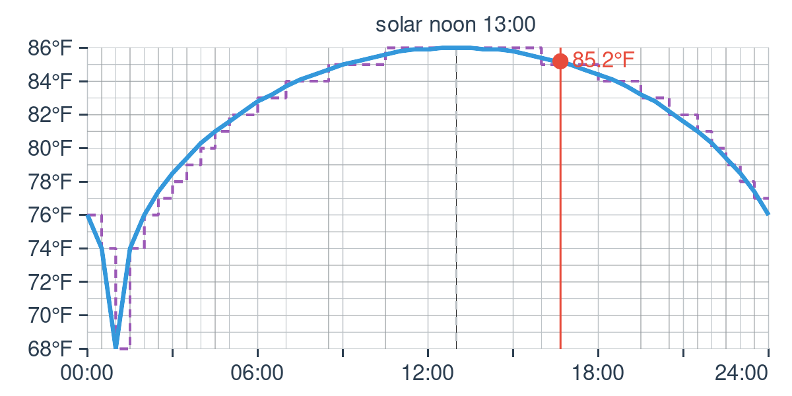
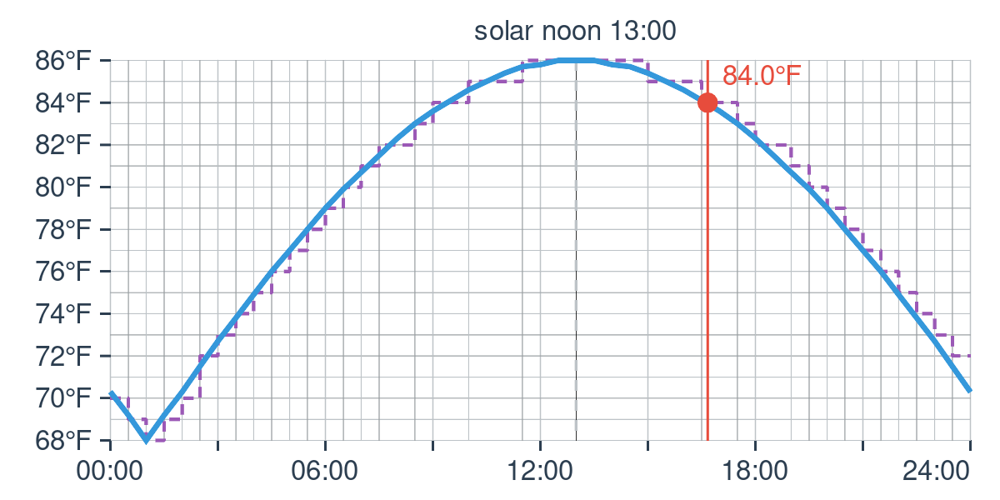
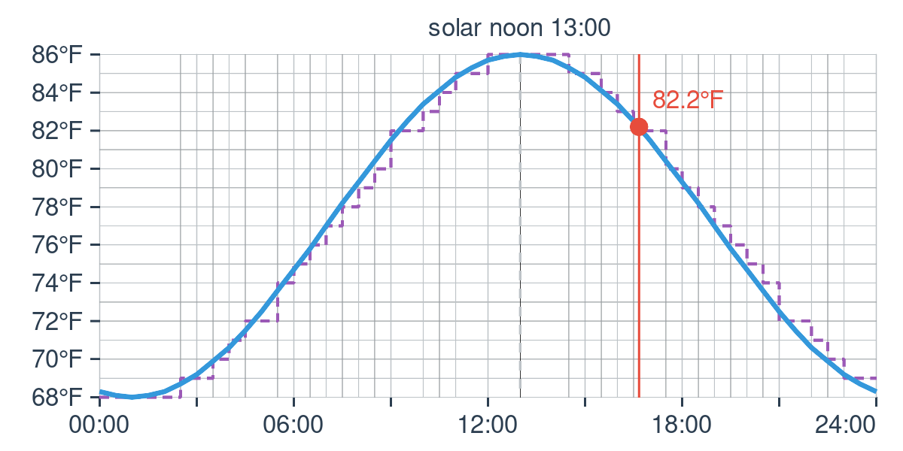
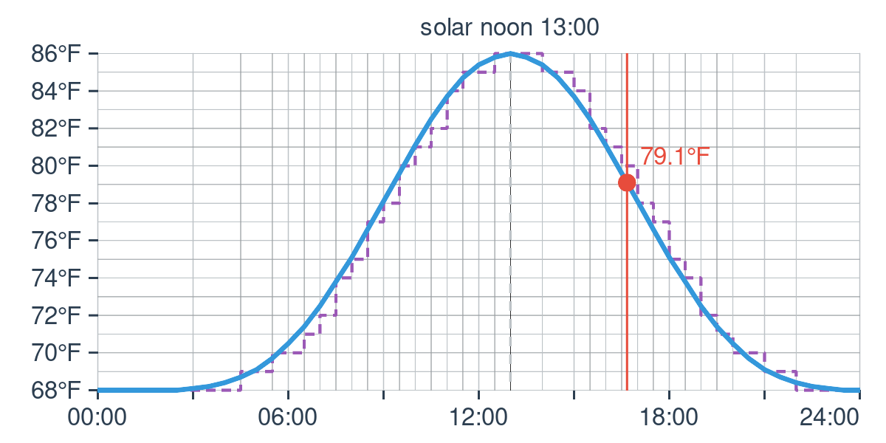
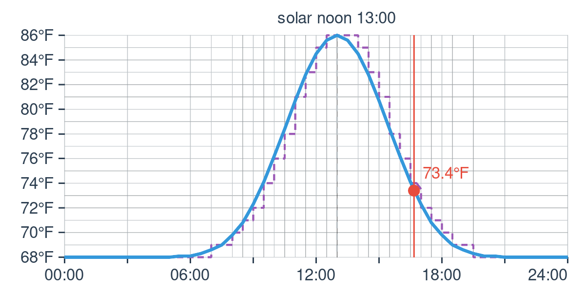

# Peak sharpness

The **Peak sharpness** setting changes the shape of the wave, not its range.
The minimum is still reached at solar midnight and the maximum at solar noon;
only the warm peak and the cool spell change.

- **Below 1.0** gives a broader peak and a shorter cool spell.
- **1.0** is a plain sine wave, the default.
- **Above 1.0** gives a sharper, shorter warm peak and a longer cool spell.

These sample charts use a 68–86 °F range (20–30 °C), noon at 13:00 and no peak
offset.

## 0.2: broad

## 0.5: broad

## 1.0: sine wave (default)

## 2.0: sharp

## 5.0: very sharp

